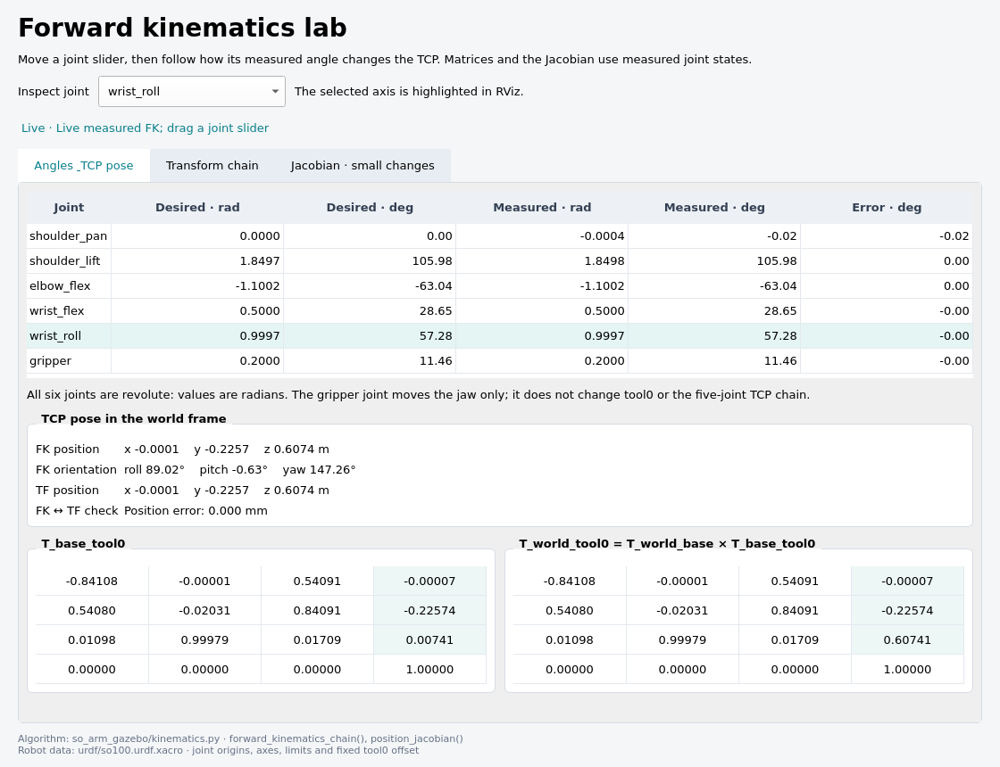

# Interactive SO100 forward-kinematics lab

Move individual joint sliders and watch the arm in Gazebo, its coordinate frames in RViz, and the corresponding matrices and tool pose in a live dashboard. This lab uses the same SO100 joint origins, axes, limits, meshes, and controllers as the pick-and-place workspace.



The lab is an **ideal kinematics experiment**. Gravity is zero, the table and ground have visual geometry only, and robot self-collision is disabled. Arbitrary in-limit angles can therefore pass through the table or other arm parts. This makes joint-transform experiments easy to observe; it does not establish that a pose is feasible for the physical arm. The robot stays fixed at world `(0, 0, 0.60)`. No hardware commands are sent.

## Start the lab

Use Ubuntu 22.04, ROS 2 Humble and Gazebo Classic 11 with the dependencies in [README.md](README.md). Install the additional viewer packages:

```bash
sudo apt install ros-humble-joint-state-publisher-gui ros-humble-rviz2 \
  ros-humble-python-qt-binding ros-humble-tf2-ros ros-humble-visualization-msgs
```

Use a terminal with no active Conda environment:

```bash
source /opt/ros/humble/setup.bash
cd /data/SO-ARM100/so-arm_ws
rosdep install --from-paths src --ignore-src --rosdistro humble -y
/usr/bin/python3 /usr/bin/colcon build --symlink-install \
  --cmake-args -DPython3_EXECUTABLE=/usr/bin/python3 -DPYTHON_EXECUTABLE=/usr/bin/python3
source install/setup.bash
ros2 launch so_arm_gazebo fk_learning.launch.py
```

The launch waits for a successful robot spawn and activation of the broadcaster, arm controller, and gripper controller before starting the lab. The default configuration opens four windows:

| Window | What to do or observe |
| --- | --- |
| Joint State Publisher | Drag a slider and read its angle in radians. **Center** restores the configured starting pose. |
| Gazebo | Watch the controlled simulated arm move toward the selected angles. |
| Forward kinematics dashboard | Compare desired/measured angles, inspect the selected joint's transforms, and read TCP pose and Jacobian values. |
| RViz | See coordinate axes, the joint chain, the TCP trail, and the selected joint's effect on TCP motion. |

The dashboard is a viewer. Its joint selector changes which joint's matrices and axis are highlighted; use the separate sliders to move the robot. A large angle change takes time because the controller respects the configured joint-speed bound. Measured values can lag desired values during motion.

All four windows can be disabled independently:

```bash
# Keep sliders and dashboard, omit both 3D viewers.
ros2 launch so_arm_gazebo fk_learning.launch.py gui:=false rviz:=false

# Run entirely headless for topic-based experiments.
ros2 launch so_arm_gazebo fk_learning.launch.py \
  gui:=false rviz:=false sliders:=false dashboard:=false
```

Press `Ctrl+C` in the launch terminal to stop the lab. Closing Gazebo also stops the launch; closing the optional viewer windows leaves the simulator running. Run this lab and the pick-and-place launch separately because they use the same robot, controllers and topics.

The built-in slider value boxes are read-only. For an exact numerical command, use the command-line example below with `sliders:=false`.

## A few experiments

1. Start at **Center**, select `shoulder_pan` in the dashboard, and change its slider from `0` to `0.3`. Follow the magenta rotation axis and the TCP trail. The downstream frames move together.
2. Select `elbow_flex` and change its angle a little. In the joint-transform tab, the fixed **origin** matrix stays constant while **motion**, **local**, and **cumulative** matrices change.
3. Change `wrist_roll`. The tool orientation changes while its position stays almost constant: the defined TCP lies on the wrist-roll axis. The wrist-roll column of the position Jacobian is consequently almost zero.
4. Move only `gripper`. The jaw opens or closes, while `tool0` and the five-joint FK result remain unchanged. The gripper is a separate branch after the arm chain.
5. Select a joint, note its Jacobian column, then increase that angle by `0.0174533` radians (one degree). Compare the measured TCP displacement with the dashboard's predicted small displacement. Return to the initial value before repeating with another joint.

RViz uses red/green/blue arrows for each frame's local X/Y/Z axes. The chain and TCP trail are cyan. Magenta shows the selected joint's rotation axis and its Jacobian-predicted TCP displacement for **+1 degree, drawn at 10 times scale** so it is visible. The displacement arrow is a local approximation, not a planned path. The optional TF display is disabled initially to keep the view clear; enable it in RViz's Displays panel if you want frame names.

## What the mathematics means

Matrices act on column vectors and are multiplied in chain order. For joint `i`, the URDF gives its fixed parent-to-joint origin translation `xyz`, origin rotation `rpy`, and local unit rotation axis `a`. The joint angle is `q`:

```text
origin_i = Translation(xyz_i) · Rz(yaw_i) · Ry(pitch_i) · Rx(roll_i)
motion_i = RotationAboutAxis(a_i, q_i)
local_i = origin_i · motion_i
cumulative_i = cumulative_(i-1) · local_i

base_tool = local_1 · local_2 · local_3 · local_4 · local_5 · Translation(0, -0.100, 0)
world_tool = Translation(0, 0, 0.60) · base_tool
```

The upper-left 3×3 block contains orientation; the last column's first three entries are position. `base_tool` describes the TCP relative to `base`. `world_tool` includes the 0.60 m mounting height. `tool0` is the TCP frame, 0.100 m along the gripper frame's negative Y axis. The dashboard's roll/pitch/yaw values are another representation of this orientation; Euler angles can change abruptly around their representation singularities even when the rotation matrix changes smoothly.

The arm chain uses these original URDF values without rounding `1.57079` to π/2:

| Joint | Origin xyz (m) | Origin rpy (rad) | Local axis | Limits (rad) |
| --- | --- | --- | --- | --- |
| `shoulder_pan` | `(0, -0.0452, 0.0165)` | `(1.57079, 0, 0)` | `(0, 1, 0)` | `[-2, 2]` |
| `shoulder_lift` | `(0, 0.1025, 0.0306)` | `(-1.8, 0, 0)` | `(1, 0, 0)` | `[0, 3.5]` |
| `elbow_flex` | `(0, 0.11257, 0.028)` | `(1.57079, 0, 0)` | `(1, 0, 0)` | `[-3.14158, 0]` |
| `wrist_flex` | `(0, 0.0052, 0.1349)` | `(-1, 0, 0)` | `(1, 0, 0)` | `[-2.5, 1.2]` |
| `wrist_roll` | `(0, -0.0601, 0)` | `(0, 1.57079, 0)` | `(0, 1, 0)` | `[-3.14158, 3.14158]` |

For a revolute joint, the position-Jacobian column is:

```text
J_i = a_i_in_base × (p_TCP_in_base - p_joint_i_in_base)
small TCP displacement ≈ J · small joint-angle change
```

The Jacobian has three position rows and five joint columns, with units metres per radian. It uses each joint's axis **after transforming it into the base frame**, not just the axis numbers written in the URDF. Because the base mounting has no rotation, its numerical position-Jacobian entries also apply to world-coordinate displacement.

The dashboard compares analytical FK with `world → tool0` TF generated from measured joint states and the URDF. The comparison uses matched joint/TF timestamps when available. It checks that the two transform implementations agree; both derive from the same measured joint data, so it is not an independent sensor measurement of the Gazebo tool.

## Topics and command-line experiments

The sliders publish desired angles on `/fk/desired_joint_states`. The learner sends controller trajectories; Gazebo's `joint_state_broadcaster` publishes actual `/joint_states`. `robot_state_publisher` and the FK report use these actual states. The sliders do not overwrite the measured-state topic.

| Topic | Message | Purpose |
| --- | --- | --- |
| `/fk/desired_joint_states` | `sensor_msgs/msg/JointState` | Desired angles from sliders or your own publisher |
| `/joint_states` | `sensor_msgs/msg/JointState` | Measured Gazebo joint states |
| `/fk/tool_pose` | `geometry_msgs/msg/PoseStamped` | Analytical TCP pose from measured joints, in `world` |
| `/fk/markers` | `visualization_msgs/msg/MarkerArray` | RViz axes, skeleton, trail and selected-joint arrows |
| `/fk/report` | `std_msgs/msg/String` | JSON with desired/measured angles, transforms, Jacobian and TF comparison |
| `/fk/selected_joint` | `std_msgs/msg/String` | Select an arm joint for marker highlighting |

For a command-line experiment, launch with `sliders:=false` so slider updates do not replace your commands. In another terminal, source the ROS and workspace setup files, then publish a partial joint command:

```bash
ros2 topic pub --once /fk/desired_joint_states sensor_msgs/msg/JointState \
  "{name: ['shoulder_pan'], position: [0.3]}"
ros2 topic echo /fk/tool_pose --once
ros2 topic echo /fk/report --once
```

Recognized joints can be updated individually. Names and values must match in length, values must be finite, and URDF limits apply. All six joints are revolute, so the gripper value is also radians, not a percentage or a jaw gap in metres.

The FK library can also be used without running Gazebo:

```bash
/usr/bin/python3 - <<'PY'
from so_arm_gazebo.kinematics import forward_kinematics_chain, position_jacobian
q = [0.0, 1.6569670531, -1.5806712649, 1.1529205386, 0.0]
chain = forward_kinematics_chain(q)
print('TCP in base:', chain['position'])
print('Base-to-tool matrix:', chain['base_tool'])
print('Position Jacobian:', position_jacobian(q))
PY
```

## Where to read and change the code

| File | Responsibility |
| --- | --- |
| [kinematics.py](src/so_arm_gazebo/so_arm_gazebo/kinematics.py) | `JOINT_ORIGINS`, `JOINT_LIMITS`, Rodrigues axis rotation, URDF RPY rotation order, `forward_kinematics_chain`, `forward_kinematics`, `position_jacobian`, and trajectory-duration calculation |
| [so100.urdf.xacro](src/so_arm_gazebo/urdf/so100.urdf.xacro) | Numeric joint origins, axes, limits, fixed base mounting, meshes and `tool0` offset |
| [fk_learning.py](src/so_arm_gazebo/so_arm_gazebo/fk_learning.py) | Desired-state validation, control bridge, measured-state FK, TF comparison, reports and RViz markers |
| [fk_dashboard.py](src/so_arm_gazebo/so_arm_gazebo/fk_dashboard.py) | Qt report viewer and selected-joint publisher |
| [fk_learning.launch.py](src/so_arm_gazebo/launch/fk_learning.launch.py) | Gazebo, clean robot description, measured-state publisher, controllers, sliders and viewers |
| [fk_learning.yaml](src/so_arm_gazebo/config/fk_learning.yaml) | Control/report rates, velocity bound, minimum motion duration, startup timeout, trail length and slider starting angles |
| [fk_learning.rviz](src/so_arm_gazebo/config/fk_learning.rviz) | Marker topic, robot display, fixed frame and camera |
| [fk_learning.world](src/so_arm_gazebo/worlds/fk_learning.world) | Visual reference table, camera, lights and zero-gravity physics |

The two demo modes share the FK library and source xacro. The learning launch omits the grasp plugin from its generated description because this world has no object to pick up. It does not modify the source xacro or the pick-and-place launch.

If you edit an origin, axis, limit, or TCP offset, update its corresponding FK constant and tests as well as the xacro. Restart the launch after changing robot or world definitions. If the dashboard is waiting for data, check that Gazebo is unpaused and `ros2 control list_controllers` shows the three controllers as active. A remote machine without a display can use the fully headless launch above and inspect the report topics.

## Verification

The mathematical suite has 29 checks, including transform-chain products, original-model consistency, and Jacobian comparison with numerical finite differences at several configurations. Run it after building:

```bash
/usr/bin/python3 /usr/bin/colcon test --event-handlers console_direct+
/usr/bin/python3 /usr/bin/colcon test-result --verbose
```

The live check uses the actual Joint State Publisher GUI widgets to command Gazebo, renders the dashboard, verifies TF and Gazebo tool-link agreement, checks upper/lower pan limits, and checks wrist-roll and jaw behavior:

```bash
# Qt widgets render offscreen; no visible windows required.
/usr/bin/python3 scripts/fk_smoke_test.py

# Also show the GUI widgets, Gazebo and RViz on your display.
/usr/bin/python3 scripts/fk_smoke_test.py --viewers
```

It uses ROS domain 74 and Gazebo port 11376 unless those environment variables are already set. Its logs and live widget screenshots are in `log/fk_smoke_test/`. The GUI test on this checkout passed, with analytical TCP positions within 0.08 mm of Gazebo across the tested poses. The final offscreen check also passed, including retained initial joint selection and clean shutdown of the learner, dashboard and server. These checks validate the teaching simulation's transforms and controls; they do not establish physical-arm accuracy.
